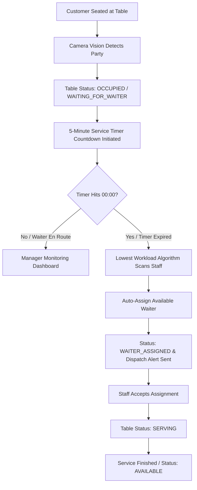

# 🍽️ DineSight AI

### Enterprise AI Restaurant Operations & Intelligent Waiter Management System


**DineSight AI** is a modern, high-performance restaurant operations management system designed for executive restaurant managers and floor supervisors. It combines multi-angle CCTV surveillance intelligence, computer vision table occupancy tracking, automated 5-minute waiter dispatch timers, and service analytics into a single centralized SaaS dashboard.

---

## 📌 Table of Contents

- [Overview](#-overview)
- [Interface Preview & Screenshots](#-interface-preview--screenshots)
- [Key Features](#-key-features)
- [System Architecture](#-system-architecture)
- [Project Structure](#-project-structure)
- [Technology Stack](#-technology-stack)
- [Getting Started](#-getting-started)
- [Live Demo Walkthrough](#-live-demo-walkthrough)
- [License](#-license)

---

## 📖 Overview

Modern high-volume dining establishments face critical operational bottlenecks:
- Delayed greeting and seating of newly arrived guests.
- Unmonitored guest dwell times and extended waits for staff assistance.
- Uneven waiter workload distribution across dining zones.
- Lack of centralized, real-time visibility into table turnover and floor capacity.

**DineSight AI** resolves these challenges by bridging surveillance feeds with operational automation:
- **Vision Tracking:** Detects table occupancy, empty glassware, customer gestures, and dwell duration.
- **SLA Countdown Engine:** Starts an automatic 5-minute countdown upon guest seating to ensure timely table-side attendance.
- **Smart Staff Dispatch:** Automatically assigns the most available waiter based on active table load.
- **Floor Telemetry:** Delivers real-time status updates across all 12 floor plan tables and dining zones.

---

## 📸 Interface Preview & Screenshots

### 🖥️ 1. Executive Operations Console
Real-time restaurant operations dashboard with instant KPI cards, customer wait-time distribution curves, dining zone occupancy breakdown, and live simulated vision incident streams.


---

### 📹 2. Multi-Angle CCTV Vision Matrix Wall
4-camera synchronized live surveillance grid monitoring the Main Dining Room, Window Seating, Private VIP Suite, and Terrace Entrance with real-time neural bounding boxes, customer gesture indicators, and millisecond OSD telemetry.


---

### 🚨 3. Incident & Alert Dispatch Log
Chronological event dispatch hub classifying computer-vision alerts (*Empty Glassware*, *Refill Needed*, *Check Requested*, *Dwell Time Escalation*) with direct one-click waiter dispatches and SLA resolution statuses.


---

### 📈 4. Service Velocity & Operational Analytics
Executive reporting suite tracking hourly diner volume vs. revenue velocity, turnover acceleration (-16m faster table turns), and waiter table-side response SLA compliance.


---

## ✨ Key Features

### 📹 1. Multi-Angle CCTV Vision Matrix
- **8 Synchronized Commercial Restaurant Camera Feeds:**
  - `Camera 01` — Main Dining Area (Sector N-1)
  - `Camera 02` — Window Seating & Terrace Facade
  - `Camera 03` — Private Dining & VIP Banquette Suite
  - `Camera 04` — Entrance, Host Reception & Foyer Pass
  - `Camera 05` — Kitchen Expediter & Hot Food Pickup Pass
  - `Camera 06` — Bar Counter & Cocktail Lounge Station
  - `Camera 07` — Front Desk, Reception & Cashier POS
  - `Camera 08` — Outdoor Garden Terrace & Al-Fresco Dining
- **Computer Vision Overlays:** Real-time bounding boxes with class tags, guest dwell duration, and gesture flags (`Hand Wave`, `Check Requested`, `Empty Glassware`).
- **Surveillance Controls:**
  - High-frequency millisecond OSD timestamp clock (`YYYY-MM-DD HH:MM:SS.mmm`).
  - Live fluctuating stream telemetry (`FPS`, `Bitrate`, `Latency`, `REC ●`).
  - Night Vision / IR Surveillance mode toggle.
  - Occupancy Density Heatmap view.
  - Digital PTZ Zoom (`1.0x`, `1.5x`, `2.0x`) and instant telemetry snapshot capture.

### 🪑 2. Interactive Restaurant Floor Plan
- **12 Architectural Tables (`T-01` to `T-12`)**:
  - Main Dining, Window Seating, Private VIP Suite, and Terrace Patio zones.
  - Live status transitions: `AVAILABLE`, `OCCUPIED`, `WAITING_FOR_WAITER`, `WAITER_ASSIGNED`, `SERVING`, and `SERVICE_COMPLETED`.
- **Table Inspector Panel:**
  - Real-time animated countdown progress bar.
  - Customer seating trigger ("Seat Customer & Start 5m Timer").
  - Table capacity, seating session ID, assigned waiter profile, and step-by-step service timeline.
  - Dynamic status filtering by occupancy and attention flags.

### 🤖 3. Intelligent Waiter Assignment & 5-Minute Timer Engine
- **Enterprise 10-Staff Operational Hierarchy:**
  - `Ahmed Rahman` (`EMP-101`) — Senior Floor Captain & Lead Expediter (Main Dining North/East)
  - `Tanvir Hasan` (`EMP-102`) — Station Captain & Senior Server (Main Dining Central)
  - `Sakib Ahmed` (`EMP-103`) — Senior Terrace & Patio Specialist (Veranda Patio)
  - `Fahim Chowdhury` (`EMP-104`) — VIP Suite Sommelier & Host (Private Dining & Bar)
  - `Nusrat Jahan` (`EMP-105`) — Beverage & Cocktail Sommelier (Bar Lounge & VIP)
  - `Mehedi Hasan` (`EMP-106`) — Dining Room Station Server (Main Dining South)
  - `Rifat Al-Mamun` (`EMP-107`) — Food Runner & Kitchen Expediter (Kitchen Pass)
  - `Shila Akter` (`EMP-108`) — Lead Hostess & Floor Coordinator (Entrance Foyer)
  - `Kamal Hossain` (`EMP-109`) — Table Busser & Sanitization Lead (Turnaround Fleet)
  - `Tariqul Islam` (`EMP-110`) — Junior Floor Server (Garden Booths)
- **Automated Lifecycle Workflow:**
  1. Customer arrives at table $\rightarrow$ Status sets to `OCCUPIED` & `WAITING_FOR_WAITER`.
  2. 5-minute countdown starts with immediate manager notification.
  3. When timer hits `00:00`, system selects available waiter with the lowest active table count.
  4. Status updates to `WAITER_ASSIGNED`, notifying staff.
  5. Waiter accepts task and transitions status to `SERVING` upon arrival table-side.
- **Simulation Speed Controls:**
  - `1x` (Real Time): Standard 1-second ticks.
  - `10x`: 5 minutes elapse in 30 seconds.
  - `60x`: 5 minutes elapse in 5 seconds (optimized for rapid demonstration).

### 📊 4. Manager Command Center & Analytics
- **6 Core Operational KPIs:**
  - Total Tables, Available Tables, Occupied Tables, Waiting for Waiter, Available Waiters, and Average Service Response Time.
- **Executive Analytics:**
  - Customer Wait Time Distribution chart.
  - Table Turnover Velocity & Session Duration tracking.
  - Staff Shift Performance & SLA Compliance leaderboard.
  - Hourly Occupancy Rate and Peak Traffic forecasting.

---

## 🔄 System Architecture



---

## 📂 Project Structure

```text
dinesight-ai/
├── docs/
│   └── screenshots/               # Production UI screenshots & live system previews
│       ├── 01-overview-dashboard.jpg
│       ├── 02-cctv-quad-matrix.jpg
│       ├── 03-incidents-dispatch.jpg
│       └── 04-service-analytics.jpg
│
├── public/
│   ├── cctv-cam01.jpg             # Camera 01 — Main Dining Area CCTV
│   ├── cctv-cam02.jpg             # Camera 02 — Window Seating CCTV
│   ├── cctv-cam03.jpg             # Camera 03 — Private Dining CCTV
│   ├── cctv-cam04.jpg             # Camera 04 — Entrance & Host Reception CCTV
│   ├── cctv-cam05.jpg             # Camera 05 — Kitchen Expediter & Hot Pass CCTV
│   ├── cctv-cam06.jpg             # Camera 06 — Bar & Cocktail Lounge CCTV
│   ├── cctv-cam07.jpg             # Camera 07 — Front Desk & Cashier POS CCTV
│   └── cctv-cam08.jpg             # Camera 08 — Outdoor Garden Terrace CCTV
│
├── src/
│   ├── components/
│   │   ├── layout/                # Persistent Dark Charcoal Sidebar & Top Navbar
│   │   ├── dashboard/             # KPI Cards, Demo Controls, Leaderboard & Activity Feed
│   │   ├── monitoring/            # CCTV Camera Feed, Detection Overlays & Lens Controls
│   │   ├── floor-plan/            # 12-Table Interactive Map & Table Inspector Panel
│   │   ├── waiters/               # Staff Cards, Live Queue & Assignment Modals
│   │   ├── notifications/         # Incident Filter Bar, Priority Alerts & Event Log
│   │   ├── analytics/             # Turnaround Velocity & Response SLA Charts
│   │   └── shared/                # Card, Badge, Button, Modal & StatCard primitives
│   │
│   ├── pages/
│   │   ├── Overview.tsx           # Executive Operations Dashboard
│   │   ├── LiveMonitoring.tsx     # 4-Channel Live CCTV Vision Matrix
│   │   ├── FloorPlan.tsx          # 12-Table Floor Plan with Live Countdown Badges
│   │   ├── WaiterManagement.tsx   # Staff Roster, Workload Balance & Waiting Queue
│   │   ├── Analytics.tsx          # Service Analytics & Dwell Time Reports
│   │   ├── Notifications.tsx      # Central Operational Alert Dispatch
│   │   └── Settings.tsx           # Shift Timing, Camera Latency & SLA Config
│   │
│   ├── data/
│   │   ├── mockTables.ts          # 12 Tables (T-01 to T-12) & Seating Configurations
│   │   ├── mockWaiters.ts         # 4 Staff Profiles (EMP-101 to EMP-104)
│   │   └── mockEvents.ts          # CCTV Feeds, Detections & Historical Incident Logs
│   │
│   ├── hooks/
│   │   ├── useRestaurantData.ts   # Central State, 5m Timer Engine, Auto-Assignment Loop
│   │   └── useClock.ts            # High-Precision Timestamp & Millisecond Heartbeat
│   │
│   ├── types/                     # TypeScript Domain Models & Interfaces
│   ├── utils/                     # Formatting & Calculation Helpers
│   ├── App.tsx                    # Route Definitions & Layout Provider
│   ├── main.tsx                   # Application Entry Point
│   └── index.css                  # Tailwind Styles, CCTV Scanlines & Radar Animations
│
├── package.json
├── tailwind.config.js
├── tsconfig.json
└── vite.config.ts
```

---

## 🛠️ Technology Stack

| Technology | Purpose |
|---|---|
| **React 19** | Component-driven user interface architecture |
| **TypeScript** | Type safety across operational domain models |
| **Vite** | Fast compilation and Hot Module Replacement |
| **Tailwind CSS** | Custom charcoal, warm white, forest green & amber palette |
| **Lucide React** | Enterprise icon system |
| **React Router v7** | Client-side routing with persistent navigation |
| **Recharts** | Interactive SVG operational metrics and analytics charts |

---

## 🚀 Getting Started

### Prerequisites

- [Node.js](https://nodejs.org/) (version 18.0 or higher recommended)
- npm or pnpm

### Installation

1. **Clone the Repository:**
   ```bash
   git clone https://github.com/CodewithShahriar/DineSight-Ai.git
   cd DineSight-Ai
   ```

2. **Install Dependencies:**
   ```bash
   npm install
   ```

3. **Launch the Development Server:**
   ```bash
   npm run dev
   ```

4. **Access the Dashboard:**
   Open your browser and navigate to:
   ```text
   http://localhost:5173
   ```

5. **Build for Production:**
   ```bash
   npm run build
   ```

---

## 🎬 Live Demo Walkthrough

### 1. Multi-Angle CCTV Monitoring (`/monitoring`)
- View all 4 live restaurant surveillance camera angles simultaneously.
- Observe bounding boxes detecting dining tables, occupied parties, and patrolling servers.
- Toggle between **AI Boxes**, **Heatmap**, and **Clean** surveillance feed modes.
- Switch to **IR Night Vision** or use **Digital Zoom (1.0x - 2.0x)** to inspect individual tables.

### 2. 5-Minute Timer & Auto-Assignment Workflow (`/floor-plan` & `/waiters`)
- Navigate to the **Restaurant Floor Plan** and select any available table.
- Click **"Seat Customer (Start 5m Timer)"** in the Table Inspector.
- Set simulation speed to **`60x`** to observe the 5-minute countdown elapse in 5 seconds.
- Watch the automated assignment select the available waiter with the lowest active table load.
- Open **Waiter Management** to accept the dispatch and initiate table service.

---

## 📄 License

This project is open-source and available under the [MIT License](LICENSE).

---

**DineSight AI — Smarter Restaurant Operations Through Intelligent Automation.**
