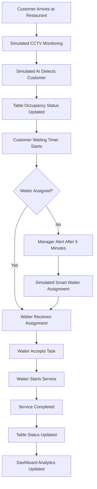

# 🍽️ DineSight AI
### AI-Powered Restaurant Table Occupancy & Waiter Assignment System


**DineSight AI** is a modern restaurant operations management dashboard designed to simulate AI-powered table occupancy monitoring, customer detection, intelligent waiter assignment, and real-time restaurant service tracking.

The project demonstrates how AI-powered CCTV monitoring and smart automation could improve restaurant efficiency, reduce customer waiting time, and optimize waiter workload.

> ⚠️ **Demo Project:** This is a frontend-only demonstration project. AI detection, CCTV monitoring, customer tracking, notifications, and waiter assignment are simulated. No real CCTV feed, AI API, backend server, or database is connected.

---

## 📌 Table of Contents

- [Overview](#-overview)
- [Project Objectives](#-project-objectives)
- [Key Features](#-key-features)
- [System Workflow](#-system-workflow)
- [Dashboard Modules](#-dashboard-modules)
- [Technology Stack](#-technology-stack)
- [Project Structure](#-project-structure)
- [Installation](#-installation)
- [Running the Project](#-running-the-project)
- [Demo Scenarios](#-demo-scenarios)
- [Future Improvements](#-future-improvements)
- [Limitations](#-limitations)
- [Screenshots](#-screenshots)
- [Contributing](#-contributing)
- [License](#-license)

---

## 📖 Overview

Restaurants often face operational challenges such as:

- Difficulty tracking table occupancy.
- Delays in assigning waiters to newly seated customers.
- Inefficient waiter workload distribution.
- Long customer waiting times.
- Lack of centralized restaurant service monitoring.

**DineSight AI** introduces a smart restaurant management concept where CCTV-style monitoring, table status tracking, customer waiting timers, and waiter assignment are combined into a single dashboard.

The system is designed for restaurant managers who need a centralized interface to monitor restaurant operations and make faster decisions.

The current version is an interactive frontend prototype built for demonstration and presentation purposes.

---

## 🎯 Project Objectives

The main objectives of DineSight AI are:

- Simulate AI-powered restaurant table occupancy detection.
- Visualize restaurant CCTV monitoring.
- Detect simulated customer arrival events.
- Track customer waiting time.
- Demonstrate automated waiter assignment.
- Monitor waiter service progress.
- Display restaurant floor plan and table status.
- Provide real-time-style operational analytics.
- Create a modern and user-friendly restaurant management interface.

---

## ✨ Key Features

### 📹 CCTV Monitoring Simulation

- CCTV-style camera monitoring interface.
- Multiple camera views.
- Simulated table occupancy detection.
- Visual representation of customer arrival.
- Camera status indicators.
- Simulated AI detection alerts.

### 🪑 Smart Table Management

- Interactive restaurant floor plan.
- Individual table status tracking.
- Occupied and available table visualization.
- Waiting customer indicators.
- Table-level operational information.

### 🤖 Intelligent Waiter Assignment Simulation

- Simulated automatic waiter assignment.
- Waiter availability tracking.
- Customer waiting timer.
- Assignment status visualization.
- Waiter workload monitoring.

### ⏱️ Customer Waiting Time Tracking

- Track how long a customer has been waiting.
- Display waiting duration.
- Trigger simulated manager alerts after a configurable waiting period.
- Visual waiting-time indicators.

### 📱 Waiter Service Portal

- Waiter task overview.
- Assigned table information.
- Service status updates.
- Simulated service workflow:
  - Assigned
  - Accepted
  - Serving
  - Completed

### 📊 Restaurant Analytics Dashboard

- Total tables.
- Occupied tables.
- Available tables.
- Waiting customers.
- Active waiters.
- Average waiting time.
- Service performance overview.

### 🔔 Alert & Notification System

- Simulated customer arrival notifications.
- Waiting-time alerts.
- Waiter assignment notifications.
- Table status change notifications.

### 🎨 Modern UI/UX

- Responsive dashboard design.
- Modern sidebar navigation.
- Interactive components.
- Clean and professional interface.
- Restaurant-focused visual design.

---

## 🔄 System Workflow

The demonstration follows this workflow:



---

## 🖥️ Dashboard Modules

### 1. Manager Dashboard

The main dashboard provides an overview of restaurant operations.

It includes:

- Restaurant performance statistics.
- Table occupancy overview.
- Customer waiting information.
- Waiter availability.
- Recent activity.
- Alerts and notifications.

### 2. CCTV Monitoring

The CCTV monitoring module simulates restaurant camera feeds.

Managers can:

- View camera panels.
- Monitor simulated table occupancy.
- Observe customer arrival scenarios.
- View simulated AI detection events.

### 3. Restaurant Floor Plan

The floor plan displays restaurant tables visually.

Each table can represent different statuses:

| Status | Description |
|---|---|
| Available | Table is currently free |
| Occupied | Customers are seated |
| Waiting | Customer is waiting for service |
| Assigned | A waiter has been assigned |
| Serving | Waiter is currently serving |
| Cleaning | Table is being prepared for the next customer |

### 4. Waiter Management

This module displays waiter information and workload.

It includes:

- Waiter name.
- Availability status.
- Assigned tables.
- Current workload.
- Service progress.

### 5. Waiter Portal

The waiter portal demonstrates the staff-side interface.

Waiters can simulate:

- Receiving a new assignment.
- Accepting a task.
- Starting service.
- Completing service.

### 6. Analytics

The analytics module presents operational insights using dashboard statistics and visual charts.

---

## 🛠️ Technology Stack

The project is developed using modern frontend technologies.

| Technology | Purpose |
|---|---|
| React | UI development |
| TypeScript | Type safety |
| Vite | Development server and build tool |
| Tailwind CSS | Styling |
| shadcn/ui | UI components |
| Lucide React | Icons |
| React Router | Navigation |
| Recharts | Data visualization |

> Update this section if the actual implementation uses a different library or technology.

---

## 📂 Project Structure

```text
dinesight-ai/
│
├── public/
│   ├── images/
│   └── videos/
│
├── src/
│   ├── assets/
│   │
│   ├── components/
│   │   ├── layout/
│   │   ├── dashboard/
│   │   ├── cctv/
│   │   ├── floor-plan/
│   │   ├── waiter/
│   │   └── ui/
│   │
│   ├── pages/
│   │   ├── Dashboard.tsx
│   │   ├── CCTVMonitoring.tsx
│   │   ├── FloorPlan.tsx
│   │   ├── WaiterManagement.tsx
│   │   ├── WaiterPortal.tsx
│   │   └── Analytics.tsx
│   │
│   ├── data/
│   │   └── mockData.ts
│   │
│   ├── hooks/
│   │
│   ├── utils/
│   │
│   ├── App.tsx
│   ├── main.tsx
│   └── index.css
│
├── .gitignore
├── package.json
├── package-lock.json
├── tsconfig.json
├── vite.config.ts
├── README.md
└── LICENSE
```

> The folder structure above is a suggested structure. Adjust it according to the actual project files.

---

## 🚀 Installation

### Prerequisites

Make sure you have the following installed:

- [Node.js](https://nodejs.org/) (LTS version recommended)
- npm
- Git

### Step 1: Clone the Repository

```bash
git clone https://github.com/YOUR-USERNAME/dinesight-ai.git
```

### Step 2: Navigate to the Project Directory

```bash
cd dinesight-ai
```

### Step 3: Install Dependencies

```bash
npm install
```

---

## ▶️ Running the Project

Start the development server:

```bash
npm run dev
```

Open the local URL displayed in your terminal, usually:

```text
http://localhost:5173
```

### Build for Production

```bash
npm run build
```

### Preview Production Build

```bash
npm run preview
```

---

## 🎬 Demo Scenarios

The following scenarios can be demonstrated during a project presentation.

### Scenario 1: New Customer Arrival

1. Open the CCTV Monitoring page.
2. Trigger a simulated customer arrival event.
3. Observe the table occupancy update.
4. View the new customer alert on the manager dashboard.

### Scenario 2: Customer Waiting for a Waiter

1. Simulate a customer waiting at a table.
2. Observe the waiting timer.
3. Allow the timer to reach the configured threshold.
4. View the simulated manager alert.

### Scenario 3: Waiter Assignment

1. Trigger the waiter assignment simulation.
2. Observe the assigned waiter.
3. Open the Waiter Portal.
4. Accept the assignment.
5. Start the service.
6. Complete the service.

### Scenario 4: Table Status Update

1. Complete the waiter service.
2. Observe the table status change.
3. Review the updated dashboard statistics.

---

## 🔮 Future Improvements

The following features could be added in future versions:

- Real CCTV camera integration.
- AI-based customer detection using YOLO or similar computer vision models.
- Backend development using Node.js and Express.
- Database integration using PostgreSQL or MongoDB.
- Real-time updates using WebSockets.
- Actual waiter assignment optimization algorithms.
- Mobile application for restaurant staff.
- Push notifications.
- Customer queue management.
- Restaurant-specific AI analytics.
- Authentication and role-based access control.
- Cloud deployment.
- Integration with restaurant POS systems.

---

## ⚠️ Limitations

The current version is a frontend-only prototype.

- No backend server is connected.
- No persistent database is used.
- CCTV footage is simulated.
- AI detection is not real.
- Waiter assignment is simulated.
- Notifications are demonstration events.
- Data may reset after refreshing the application.

This project demonstrates the concept and user experience of an AI-powered restaurant operations system rather than a production-ready AI solution.

---

## 📸 Screenshots

Add screenshots of your project here after capturing them from the running application.

```markdown


```

---

## 🤝 Contributing

Contributions, suggestions, and improvements are welcome.

To contribute:

1. Fork the repository.
2. Create a new branch.

```bash
git checkout -b feature/your-feature-name
```

3. Commit your changes.

```bash
git commit -m "Add your feature"
```

4. Push your branch.

```bash
git push origin feature/your-feature-name
```

5. Open a Pull Request.

---

## 📄 License

This project is licensed under the MIT License.

You are free to use, modify, and distribute this project according to the terms of the license.

See the [LICENSE](LICENSE) file for details.

---

## 👨‍💻 Author

**Abid Shahriar**

CSE Student | Frontend Developer

GitHub: [YOUR-GITHUB-USERNAME](https://github.com/YOUR-GITHUB-USERNAME)

---

## ⭐ Support

If you find this project interesting or useful, consider giving it a ⭐ on GitHub.

**DineSight AI — Smarter Restaurant Operations Through Intelligent Automation.**
# 🍽️ DineSight AI
### AI-Powered Restaurant Table Occupancy & Waiter Assignment System


**DineSight AI** is a modern restaurant operations management dashboard designed to simulate AI-powered table occupancy monitoring, customer detection, intelligent waiter assignment, and real-time restaurant service tracking.

The project demonstrates how AI-powered CCTV monitoring and smart automation could improve restaurant efficiency, reduce customer waiting time, and optimize waiter workload.

> ⚠️ **Demo Project:** This is a frontend-only demonstration project. AI detection, CCTV monitoring, customer tracking, notifications, and waiter assignment are simulated. No real CCTV feed, AI API, backend server, or database is connected.

---

## 📌 Table of Contents

- [Overview](#-overview)
- [Project Objectives](#-project-objectives)
- [Key Features](#-key-features)
- [System Workflow](#-system-workflow)
- [Dashboard Modules](#-dashboard-modules)
- [Technology Stack](#-technology-stack)
- [Project Structure](#-project-structure)
- [Installation](#-installation)
- [Running the Project](#-running-the-project)
- [Demo Scenarios](#-demo-scenarios)
- [Future Improvements](#-future-improvements)
- [Limitations](#-limitations)
- [Screenshots](#-screenshots)
- [Contributing](#-contributing)
- [License](#-license)

---

## 📖 Overview

Restaurants often face operational challenges such as:

- Difficulty tracking table occupancy.
- Delays in assigning waiters to newly seated customers.
- Inefficient waiter workload distribution.
- Long customer waiting times.
- Lack of centralized restaurant service monitoring.

**DineSight AI** introduces a smart restaurant management concept where CCTV-style monitoring, table status tracking, customer waiting timers, and waiter assignment are combined into a single dashboard.

The system is designed for restaurant managers who need a centralized interface to monitor restaurant operations and make faster decisions.

The current version is an interactive frontend prototype built for demonstration and presentation purposes.

---

## 🎯 Project Objectives

The main objectives of DineSight AI are:

- Simulate AI-powered restaurant table occupancy detection.
- Visualize restaurant CCTV monitoring.
- Detect simulated customer arrival events.
- Track customer waiting time.
- Demonstrate automated waiter assignment.
- Monitor waiter service progress.
- Display restaurant floor plan and table status.
- Provide real-time-style operational analytics.
- Create a modern and user-friendly restaurant management interface.

---

## ✨ Key Features

### 📹 CCTV Monitoring Simulation

- CCTV-style camera monitoring interface.
- Multiple camera views.
- Simulated table occupancy detection.
- Visual representation of customer arrival.
- Camera status indicators.
- Simulated AI detection alerts.

### 🪑 Smart Table Management

- Interactive restaurant floor plan.
- Individual table status tracking.
- Occupied and available table visualization.
- Waiting customer indicators.
- Table-level operational information.

### 🤖 Intelligent Waiter Assignment Simulation

- Simulated automatic waiter assignment.
- Waiter availability tracking.
- Customer waiting timer.
- Assignment status visualization.
- Waiter workload monitoring.

### ⏱️ Customer Waiting Time Tracking

- Track how long a customer has been waiting.
- Display waiting duration.
- Trigger simulated manager alerts after a configurable waiting period.
- Visual waiting-time indicators.

### 📱 Waiter Service Portal

- Waiter task overview.
- Assigned table information.
- Service status updates.
- Simulated service workflow:
  - Assigned
  - Accepted
  - Serving
  - Completed

### 📊 Restaurant Analytics Dashboard

- Total tables.
- Occupied tables.
- Available tables.
- Waiting customers.
- Active waiters.
- Average waiting time.
- Service performance overview.

### 🔔 Alert & Notification System

- Simulated customer arrival notifications.
- Waiting-time alerts.
- Waiter assignment notifications.
- Table status change notifications.

### 🎨 Modern UI/UX

- Responsive dashboard design.
- Modern sidebar navigation.
- Interactive components.
- Clean and professional interface.
- Restaurant-focused visual design.

---

## 🔄 System Workflow

The demonstration follows this workflow:


---

## 🖥️ Dashboard Modules

### 1. Manager Dashboard

The main dashboard provides an overview of restaurant operations.

It includes:

- Restaurant performance statistics.
- Table occupancy overview.
- Customer waiting information.
- Waiter availability.
- Recent activity.
- Alerts and notifications.

### 2. CCTV Monitoring

The CCTV monitoring module simulates restaurant camera feeds.

Managers can:

- View camera panels.
- Monitor simulated table occupancy.
- Observe customer arrival scenarios.
- View simulated AI detection events.

### 3. Restaurant Floor Plan

The floor plan displays restaurant tables visually.

Each table can represent different statuses:

| Status | Description |
|---|---|
| Available | Table is currently free |
| Occupied | Customers are seated |
| Waiting | Customer is waiting for service |
| Assigned | A waiter has been assigned |
| Serving | Waiter is currently serving |
| Cleaning | Table is being prepared for the next customer |

### 4. Waiter Management

This module displays waiter information and workload.

It includes:

- Waiter name.
- Availability status.
- Assigned tables.
- Current workload.
- Service progress.

### 5. Waiter Portal

The waiter portal demonstrates the staff-side interface.

Waiters can simulate:

- Receiving a new assignment.
- Accepting a task.
- Starting service.
- Completing service.

### 6. Analytics

The analytics module presents operational insights using dashboard statistics and visual charts.

---

## 🛠️ Technology Stack

The project is developed using modern frontend technologies.

| Technology | Purpose |
|---|---|
| React | UI development |
| TypeScript | Type safety |
| Vite | Development server and build tool |
| Tailwind CSS | Styling |
| shadcn/ui | UI components |
| Lucide React | Icons |
| React Router | Navigation |
| Recharts | Data visualization |

> Update this section if the actual implementation uses a different library or technology.

---

## 📂 Project Structure

```text
dinesight-ai/
│
├── public/
│   ├── images/
│   └── videos/
│
├── src/
│   ├── assets/
│   │
│   ├── components/
│   │   ├── layout/
│   │   ├── dashboard/
│   │   ├── cctv/
│   │   ├── floor-plan/
│   │   ├── waiter/
│   │   └── ui/
│   │
│   ├── pages/
│   │   ├── Dashboard.tsx
│   │   ├── CCTVMonitoring.tsx
│   │   ├── FloorPlan.tsx
│   │   ├── WaiterManagement.tsx
│   │   ├── WaiterPortal.tsx
│   │   └── Analytics.tsx
│   │
│   ├── data/
│   │   └── mockData.ts
│   │
│   ├── hooks/
│   │
│   ├── utils/
│   │
│   ├── App.tsx
│   ├── main.tsx
│   └── index.css
│
├── .gitignore
├── package.json
├── package-lock.json
├── tsconfig.json
├── vite.config.ts
├── README.md
└── LICENSE
```

> The folder structure above is a suggested structure. Adjust it according to the actual project files.

---

## 🚀 Installation

### Prerequisites

Make sure you have the following installed:

- [Node.js](https://nodejs.org/) (LTS version recommended)
- npm
- Git

### Step 1: Clone the Repository

```bash
git clone https://github.com/YOUR-USERNAME/dinesight-ai.git
```

### Step 2: Navigate to the Project Directory

```bash
cd dinesight-ai
```

### Step 3: Install Dependencies

```bash
npm install
```

---

## ▶️ Running the Project

Start the development server:

```bash
npm run dev
```

Open the local URL displayed in your terminal, usually:

```text
http://localhost:5173
```

### Build for Production

```bash
npm run build
```

### Preview Production Build

```bash
npm run preview
```

---

## 🎬 Demo Scenarios

The following scenarios can be demonstrated during a project presentation.

### Scenario 1: New Customer Arrival

1. Open the CCTV Monitoring page.
2. Trigger a simulated customer arrival event.
3. Observe the table occupancy update.
4. View the new customer alert on the manager dashboard.

### Scenario 2: Customer Waiting for a Waiter

1. Simulate a customer waiting at a table.
2. Observe the waiting timer.
3. Allow the timer to reach the configured threshold.
4. View the simulated manager alert.

### Scenario 3: Waiter Assignment

1. Trigger the waiter assignment simulation.
2. Observe the assigned waiter.
3. Open the Waiter Portal.
4. Accept the assignment.
5. Start the service.
6. Complete the service.

### Scenario 4: Table Status Update

1. Complete the waiter service.
2. Observe the table status change.
3. Review the updated dashboard statistics.

---

## 🔮 Future Improvements

The following features could be added in future versions:

- Real CCTV camera integration.
- AI-based customer detection using YOLO or similar computer vision models.
- Backend development using Node.js and Express.
- Database integration using PostgreSQL or MongoDB.
- Real-time updates using WebSockets.
- Actual waiter assignment optimization algorithms.
- Mobile application for restaurant staff.
- Push notifications.
- Customer queue management.
- Restaurant-specific AI analytics.
- Authentication and role-based access control.
- Cloud deployment.
- Integration with restaurant POS systems.

---

## 📸 Screenshots

Add screenshots of your project here after capturing them from the running application.

```markdown


```

---


## 📄 License

This project is licensed under the MIT License.

You are free to use, modify, and distribute this project according to the terms of the license.

See the [LICENSE](LICENSE) file for details.

---

