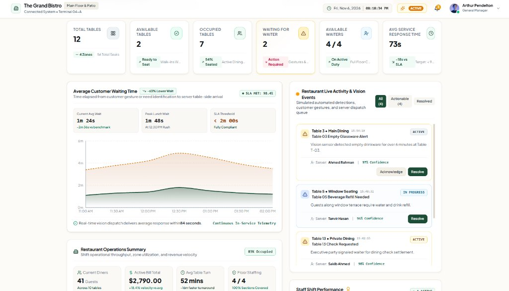
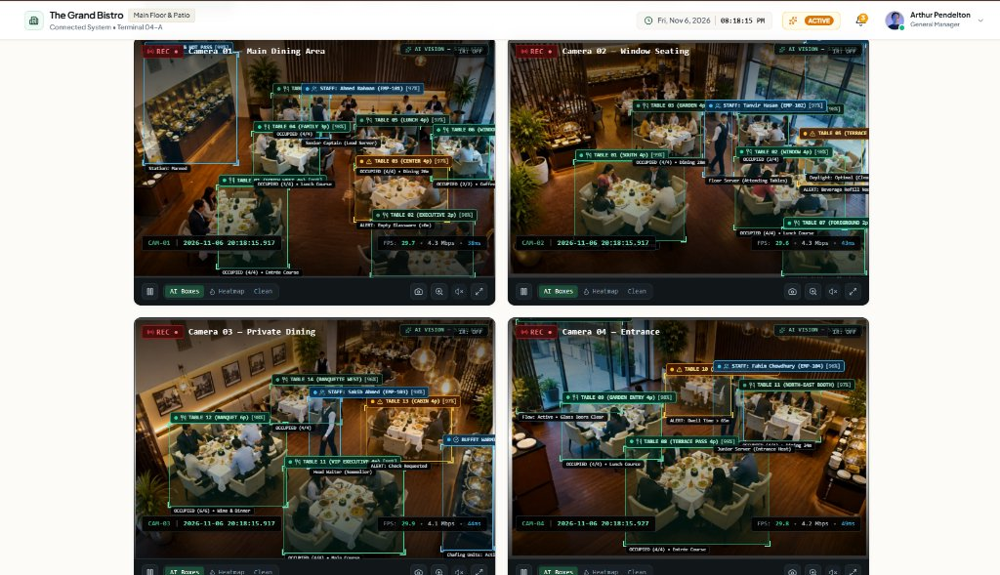
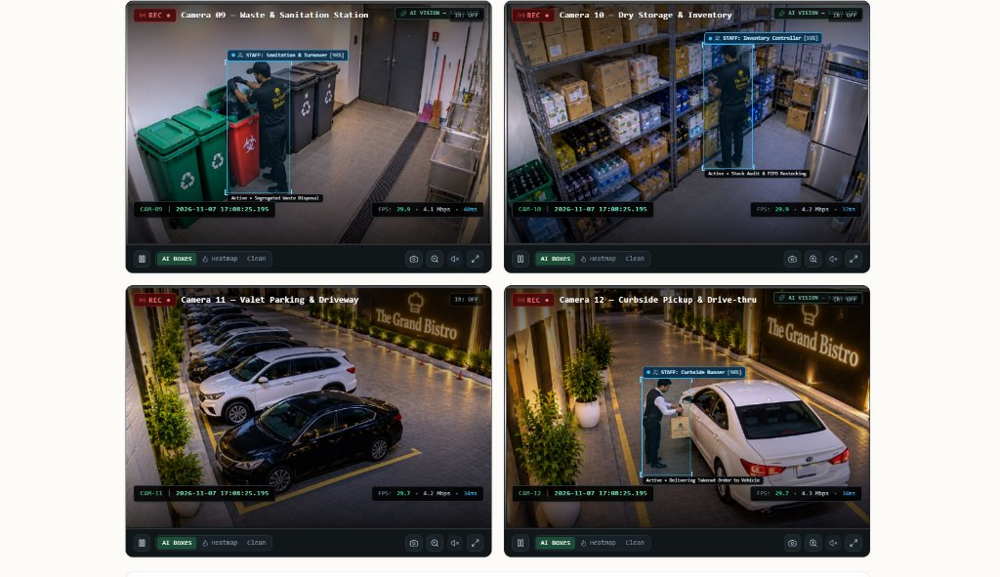
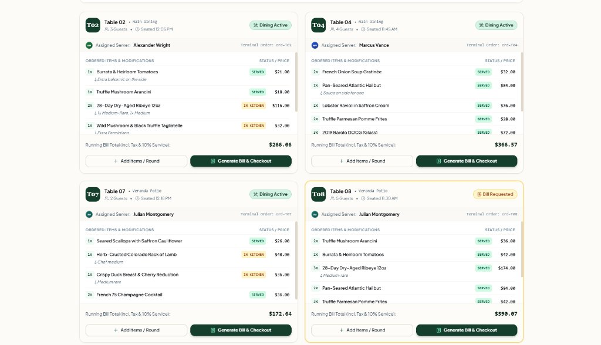
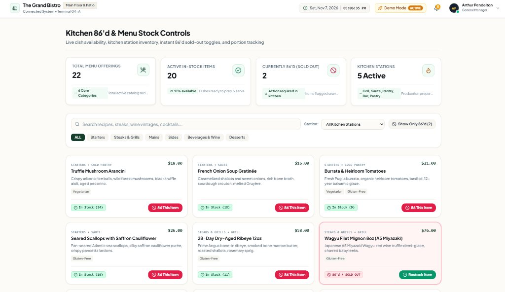
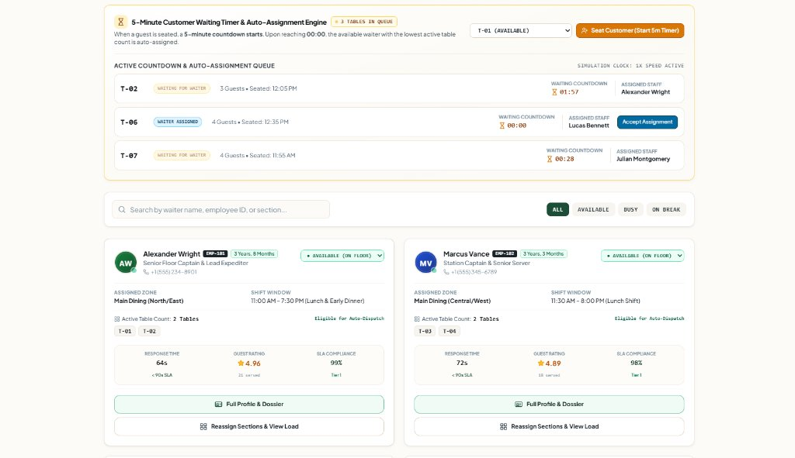
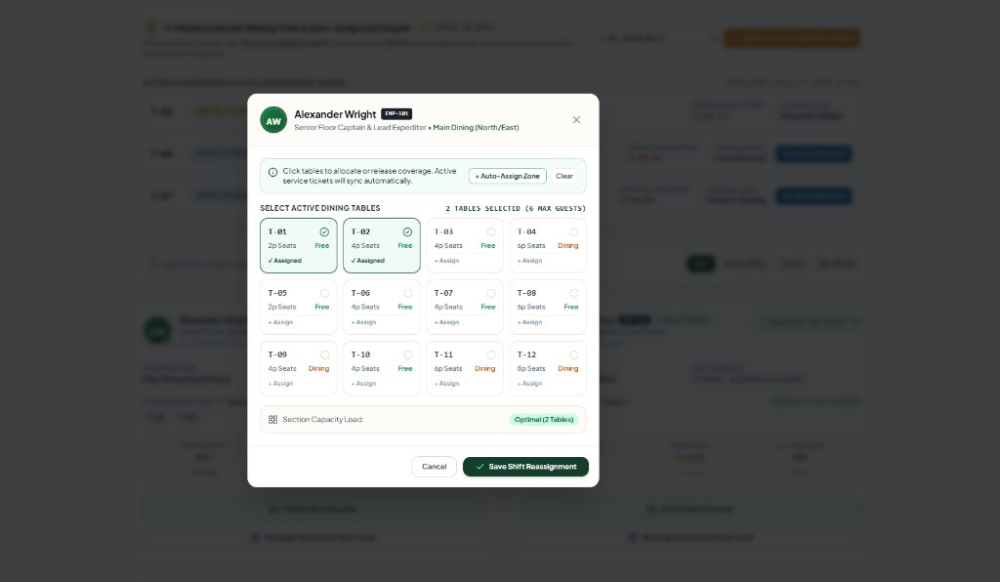
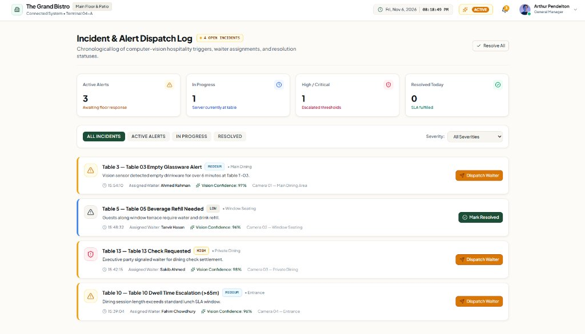
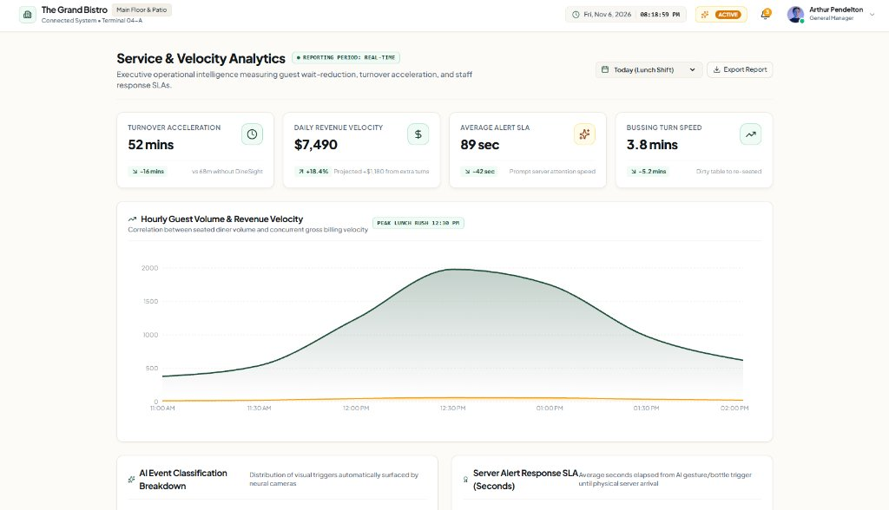
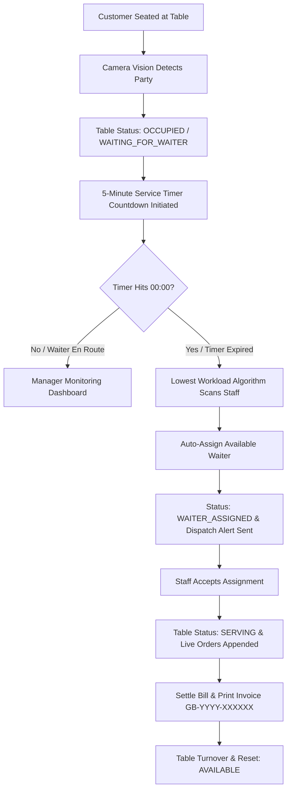

# 🍽️ DineSight AI

### Enterprise AI Restaurant Operations & Intelligent Waiter Management System


[](https://react.dev/)
[](https://www.typescriptlang.org/)
[](https://vitejs.dev/)
[](https://tailwindcss.com/)
[](docs/DineSight_AI_SRS.pdf)
[](LICENSE)

**DineSight AI** is an enterprise-grade restaurant operations command system engineered for executive restaurant managers, floor captains, and hospitality teams. It unifies **12-angle synchronized CCTV surveillance intelligence**, **computer-vision table occupancy tracking**, **an automated 5-minute waiter dispatch engine**, **live table ordering and guest billing**, **kitchen 86'd menu inventory toggles**, and **comprehensive staff dossiers** into a high-performance SaaS dashboard.

---

## 📌 Table of Contents

- [Overview](#-overview)
- [Software Requirements Specification (SRS)](#-software-requirements-specification-srs)
- [Interface Preview & Screenshots](#-interface-preview--screenshots)
- [Key Features](#-key-features)
- [System Architecture](#-system-architecture)
- [Technology Stack](#-technology-stack)
- [Getting Started](#-getting-started)
- [Live Demo Walkthrough](#-live-demo-walkthrough)
- [License](#-license)

---

## 📖 Overview

High-volume fine-dining and commercial restaurants face persistent operational bottlenecks:
- **Delayed Guest Attendance:** Newly arrived parties experience unmonitored dwell times before being greeted by servers.
- **Asymmetrical Server Workloads:** Disproportionate table assignments lead to staff burnout and delayed food service.
- **Disconnected POS & Kitchen Inventory:** Communication gaps between floor servers and kitchen pass lines regarding sold-out (*86'd*) ingredients.
- **Fragmented Incident Resolution:** Lack of centralized oversight over customer requests, empty beverage carafes, and table turnover velocity.

**DineSight AI** eliminates these challenges through intelligent automation:
1. **Computer Vision Intelligence:** Simulates real-time neural detection overlays tracking table occupancy, guest gestures (`Hand Wave`, `Check Requested`, `Empty Glassware`), and patrolling staff across **12 commercial camera angles**.
2. **Automated 5-Minute Dispatch Timer:** Automatically triggers a 300-second countdown when a party is seated. If unserved upon timer expiry, a greedy algorithm dispatches the available server with the lowest active table load.
3. **Live Table Orders & Checkout:** Manages course additions (Round 1, Round 2), compounding subtotal, 8.25% sales tax, 10% service gratuity, selectable tips, and prints formal invoices (`GB-YYYY-XXXXXX`).
4. **Kitchen 86'd & Stock Controls:** 1-click instant sold-out toggle synchronized across floor menus and ordering modals with portion depletion meters.
5. **Staff Dossiers & Shift Reassignment:** Full personal profiles detailing tenure, emergency contacts, blood groups, certifications, and portaled 12-table section allocation.

---

## 📄 Software Requirements Specification (SRS)

A formal, IEEE Std 830-1998 compliant **Software Requirements Specification (SRS)** has been authored and approved for DineSight AI Version 2.0:

- **[📥 Download DineSight AI SRS (PDF Document)](docs/DineSight_AI_SRS.pdf)** *(Publication-Ready Formal Specification)*
- **[📖 View SRS Markdown Document](docs/DineSight_AI_SRS.md)** *(Full GitHub-Formatted Specification)*

### SRS Document Overview:
| Section | Scope |
|---|---|
| **Section 1 & 2** | Executive Abstract, Scope, Terminology (OSD, 86'd, Greedy Dispatch), User Personas (GM, Captain, Waiter, Expediter, Host). |
| **Section 3** | System Architecture Pipeline, Data Flow Diagrams, High-Frequency CCTV OSD Telemetry Specifications. |
| **Section 4** | Complete Functional Requirements: **FR-1** (12 CCTV Feeds), **FR-2** (12-Table Floor Plan), **FR-3** (5m Dispatch Engine), **FR-4** (Live Billing & Receipts), **FR-5** (Kitchen 86'd Stock), **FR-6** (Staff Dossiers & Reassignments), **FR-7** (Analytics). |
| **Section 5 & 6** | Non-Functional Requirements (Latency <50ms, 99.95% Uptime, HACCP Level 3 Food Hygiene, 220ms Zero-Shift Transitions) & QA Test Matrix. |

---

## 📸 Interface Preview & Screenshots

### 🖥️ 1. Executive Operations Console
Centralized command center tracking floor capacity KPIs, customer wait-time distribution curves, dining zone occupancy breakdowns, and live vision incident feeds.



---

### 📹 2. Front-of-House CCTV Vision Matrix Wall
Synchronized commercial surveillance grid monitoring the Main Dining Room, Window Seating, Private VIP Suite, and Entrance Reception with real-time bounding boxes and millisecond OSD telemetry.



---

### 📦 3. Backstage, Logistics & Parking CCTV Surveillance Matrix
Surveillance coverage spanning Camera 09 (Waste & Sanitation Station), Camera 10 (Dry Storage & Provisions Cellar), Camera 11 (Valet Parking Lot), and Camera 12 (Curbside Pickup Vehicle Handoff) with active computer-vision staff detection.



---

### 🧾 4. Live Table Orders, Course Rounds & Billing Tickets
Live table order management displaying active dining course tickets (Round 1, Round 2), running subtotals, item modification notes, and 1-click checkout buttons.



---

### 🚫 5. Kitchen 86'd & Menu Stock Controls
Real-time culinary stock dashboard with station categorization (Grill, Sauté, Pantry, Pastry, Bar), portion depletion meters, and 1-click instant sold-out (*86'd*) toggles.



---

### 🤖 6. Waiter Management & 5-Minute Auto-Dispatch Engine
10-staff enterprise roster, sub-second waiting countdown queue, waiter availability selectors, and matching full-width action buttons for profile dossiers and section reassignments.



---

### 🪑 7. Interactive 12-Table Section Reassignment Modal
Portaled full-screen modal with background scroll lock, 12-table visual selection grid, automatic zone allocation shortcuts, and live dining capacity load calculation.



---

### 🚨 8. Real-Time Incident & Alert Dispatch Log
Chronological event hub classifying computer-vision alerts (*Empty Glassware*, *Beverage Refill Needed*, *Check Requested*, *Dwell Time Escalation*) with 1-click waiter dispatches.



---

### 📈 9. Service Velocity & Operational Analytics Suite
Executive reporting tracking hourly volume vs. revenue velocity, turnover acceleration (-16m faster table turns), and server table-side response SLA compliance.



---

## ✨ Key Features

### 📹 1. 12-Angle Commercial CCTV Vision Matrix
- **12 Synchronized Commercial Surveillance Feeds:**
  - `Camera 01` — Main Dining Area (North/East Sector)
  - `Camera 02` — Window Seating & Terrace Facade
  - `Camera 03` — Private Dining & VIP Banquette Suite
  - `Camera 04` — Entrance Foyer & Host Reception Pass
  - `Camera 05` — Kitchen Expediter Pass & Hot Food Station
  - `Camera 06` — Bar Counter & Cocktail Mixology Station
  - `Camera 07` — Front Desk, Reception & Cashier POS
  - `Camera 08` — Outdoor Garden Terrace & Al-Fresco Dining
  - `Camera 09` — Waste & Sanitation Station (Staff Waste Sorting)
  - `Camera 10` — Dry Storage & Provisions Cellar (Stock Audit)
  - `Camera 11` — Valet Parking Lot & Arrival Driveway (Clear Bay View)
  - `Camera 12` — Curbside Pickup & VIP Drive-thru (Vehicle Delivery Handoff)
- **Computer Vision Overlays:** Real-time bounding boxes with class tags, confidence scores, and guest gesture flags.
- **Surveillance Controls:**
  - High-precision millisecond OSD timestamp clock (`YYYY-MM-DD HH:MM:SS.mmm`).
  - Dynamic stream telemetry (`FPS`, `Bitrate`, `Latency`, `REC ●`).
  - Algorithmic human thermal heatmap layer.
  - Night Vision / IR phosphorus green filter.
  - Digital PTZ Zoom (`1.0x`, `1.5x`, `2.0x`) and instant telemetry snapshot capture.

### 🪑 2. Interactive Restaurant Floor Plan
- **12 Architectural Tables (`T-01` to `T-12`)**:
  - Main Dining, Window Seating, Private VIP Suite, and Veranda Patio zones.
  - Lifecycle status transitions: `AVAILABLE`, `OCCUPIED`, `WAITING_FOR_WAITER`, `WAITER_ASSIGNED`, `SERVING`, and `SERVICE_COMPLETED`.
- **Table Inspector Drawer:**
  - Real-time animated countdown progress bar.
  - Customer seating trigger ("Seat Customer & Start 5m Timer").
  - Table capacity, seating session ID, assigned waiter profile, and step-by-step service timeline.

### 🤖 3. Intelligent Waiter Assignment & 5-Minute Timer Engine
- **10-Staff Enterprise Operational Roster:**
  - `Alexander Wright` (`EMP-101`) — Senior Floor Captain & Lead Expediter (Main Dining North/East)
  - `Marcus Vance` (`EMP-102`) — Station Captain & Senior Server (Main Dining Central)
  - `Julian Montgomery` (`EMP-103`) — Senior Terrace & Patio Specialist (Veranda Patio)
  - `Christian Laurent` (`EMP-104`) — VIP Suite Sommelier & Host (Private Dining & Bar)
  - `Elena Rostova` (`EMP-105`) — Beverage & Cocktail Sommelier (Bar Lounge & VIP)
  - `Lucas Bennett` (`EMP-106`) — Dining Room Station Server (Main Dining South)
  - `Dominic Sterling` (`EMP-107`) — Food Runner & Kitchen Expediter (Kitchen Pass)
  - `Sophia Chen` (`EMP-108`) — Lead Hostess & Floor Coordinator (Entrance Foyer)
  - `Oliver Hayes` (`EMP-109`) — Table Busser & Sanitization Lead (Turnaround Fleet)
  - `Gabriel Silva` (`EMP-110`) — Junior Floor Server (Garden Booths)
- **Automated Lifecycle Workflow:**
  1. Party seated $\rightarrow$ Status sets to `OCCUPIED` & `WAITING_FOR_WAITER`.
  2. 5-minute countdown starts with visual manager alert.
  3. On timer zero (`00:00`), greedy algorithm dispatches available waiter with lowest table count.
  4. Status transitions to `WAITER_ASSIGNED`, notifying staff.
  5. Waiter arrives table-side and transitions status to `SERVING`.
- **Simulation Speed Controls:**
  - `1x` (Real Time): Standard 1-second ticks.
  - `10x`: 5 minutes elapse in 30 seconds.
  - `60x`: 5 minutes elapse in 5 seconds (rapid demonstration mode).

### 🧾 4. Live Table Orders & Guest Billing
- **Live Dining Carts:** Track ordered items, round courses (Round 1, Round 2), and kitchen modifiers per table.
- **Item Additions Modal (`AddItemModal`):** Browse dishes by station with dietary flags and sold-out guards.
- **Financial Calculation Engine:** Subtotal + 8.25% Sales Tax + 10% Service Gratuity + Selectable Staff Tips (15%, 18%, 20%, or custom).
- **Printable Invoices:** Format formal guest receipts (`GB-YYYY-XXXXXX`) with `window.print()` support.
- **Billing Reversal & Demo Reset:** 1-click `Mark Unpaid (Reopen)` and `Reset Orders Demo` for effortless demo testing.

### 🚫 5. Kitchen 86'd & Menu Stock Controls
- **Instant Sold-Out Toggles:** 1-click availability flip instantly disabling dishes in floor ordering modals.
- **Kitchen Station Filters:** Grill Station, Sauté Station, Cold Pantry, Pastry Station, and Cocktail Bar.
- **Portion Depletion Gauges:** Track remaining portions with visual warning badges as quantities reach zero.

### 👤 6. Staff Dossiers & Section Reassignment
- **Comprehensive Staff Profiles (`WaiterDetailsModal`):**
  - Tenure (e.g. `3 Years, 8 Months`) and joining date.
  - Lifetime tables served, today's tips, and guest satisfaction ratings.
  - Personal contact info: official email, telephone, and verified residential address.
  - Emergency dossier: contact person, relationship, telephone, and Blood Group badge (`O+`, `A+`, `B+`).
  - HR verification: date of birth, age, right-to-work permit, contract type, and tax/NI number.
  - Professional certifications (WSET, HACCP, Silver Service) and spoken languages.
  - Management appraisal and confidential supervisor notes.
- **Portaled 12-Table Reassignment (`ReassignTablesModal`):**
  - Portaled to `document.body` with `z-[100]` and background scroll lock (`overflow: hidden`).
  - Interactive 12-table visual selection with automatic zone selection shortcut.
  - Live capacity calculator tracking tables and maximum guest load.

---

## 🔄 System Architecture



---

## 🛠️ Technology Stack

| Technology | Purpose |
|---|---|
| **React 19** | Component-driven user interface architecture with optimized DOM reconciliation |
| **TypeScript 7.0** | Strict type safety across operational models, billing structures, and staff records |
| **Vite 8.3** | High-performance bundling and sub-second Hot Module Replacement (HMR) |
| **Tailwind CSS 3.4** | Bespoke design system (charcoal, forest green, warm white & amber accents) |
| **React Router v7** | Client-side routing with smooth zero-shift micro-slide page transitions (`220ms`) |
| **Recharts** | Interactive SVG operational metrics, wait-time curves, and turnaround graphs |
| **Lucide React** | Enterprise icon system |

---

## 🚀 Getting Started

### Prerequisites
- [Node.js](https://nodejs.org/) (version 18.0 or higher recommended)
- npm or pnpm

### Installation

1. **Clone the Repository:**
   ```bash
   git clone https://github.com/CodewithShahriar/DineSight-Ai.git
   cd DineSight-Ai
   ```

2. **Install Dependencies:**
   ```bash
   npm install
   ```

3. **Launch the Development Server:**
   ```bash
   npm run dev
   ```

4. **Access the Dashboard:**
   Open your browser and navigate to:
   ```text
   http://localhost:5173
   ```

5. **Build for Production:**
   ```bash
   npm run build
   ```

---

## 🎬 Live Demo Walkthrough

### 1. Multi-Angle CCTV Monitoring (`/monitoring`)
- View all 12 synchronized commercial restaurant camera angles.
- Inspect simulated neural bounding boxes, staff detection on sanitation/store/curbside, and guest gesture flags.
- Toggle between **AI Overlays**, **Thermal Heatmap**, and **Clean Feed** modes.
- Switch to **IR Night Vision** or use **Digital Zoom (1.0x - 2.0x)** to inspect specific tables.

### 2. 5-Minute Timer & Auto-Assignment Workflow (`/floor-plan` & `/waiters`)
- Navigate to the **Restaurant Floor Plan** and select any available table.
- Click **"Seat Customer (Start 5m Timer)"** in the Table Inspector.
- Set simulation speed to **`60x`** to observe the 5-minute countdown elapse in 5 seconds.
- Watch the automated assignment select the available waiter with the lowest active table load.
- Open **Waiter Management** to accept the dispatch and initiate table service.

### 3. Live Table Orders & Billing (`/orders`)
- Select an active table card to review its ordered course ticket.
- Click **"Add Items / Round"** to append new appetizers, entrees, or drinks.
- Click **"Generate Bill & Checkout"** to open the guest check invoice modal.
- Select tip percentage (15%, 18%, 20%, or custom), choose payment method (Card/Cash/Apple Pay), and click **"Settle & Complete Bill"**.
- Print the formal receipt or click **"Mark as Unpaid (Reopen)"** to test billing reversals.

### 4. Kitchen 86'd Menu Stock (`/menu-stock`)
- Navigate to **Kitchen 86'd & Menu Stock**.
- Flip any dish to **"86'd / Sold Out"** with a single click.
- Navigate to **Live Orders** $\rightarrow$ click **"Add Items / Round"** and observe that the 86'd dish is immediately disabled with a red *Sold Out* badge.

### 5. Staff Dossier & Shift Reassignment (`/waiters`)
- In **Waiter Management**, click **"Full Profile & Dossier"** on any waiter card.
- Review service tenure, emergency contact, blood group, certifications, spoken languages, and manager appraisal notes.
- Click **"Reassign Sections & View Load"** to open the interactive 12-table visual allocation modal with live capacity counters.

---

## 📄 License

This project is open-source and available under the [MIT License](LICENSE).

---

**DineSight AI — Smarter Restaurant Operations Through Intelligent Automation.**
