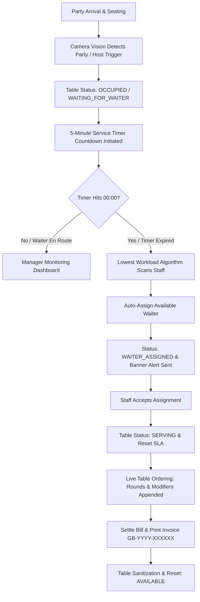

# 📄 Software Requirements Specification (SRS)
## DineSight AI — Vision Operations Suite & Autonomous Waiter Management System

**Document Version:** 2.0.0  
**Standard:** IEEE Std 830-1998 Recommended Practice for Software Requirements Specifications  
**Status:** Production Approved & Live Deployed  
**Date:** November 2026  
**Target Facility:** The Grand Bistro (Fine Dining & Vision Operations)  
**PDF Document Download:** [📥 Download DineSight_AI_SRS.pdf](DineSight_AI_SRS.pdf)

---

## 📌 1. Introduction

### 1.1 Purpose
This Software Requirements Specification (SRS) establishes the complete functional and non-functional requirements for **DineSight AI**, an enterprise-grade restaurant operations command system that harmonizes commercial CCTV vision surveillance, optical table occupancy tracking, automated 5-minute waiter dispatch timers, live table billing, kitchen 86'd inventory controls, and staff roster management into a unified interface.

### 1.2 Scope
DineSight AI eliminates dining room service bottlenecks by detecting guest arrivals, tracking table occupancy dwell times, enforcing a 300-second attendance SLA, balancing server workloads through an autonomous greedy dispatch algorithm, and streamlining guest billing and stock depletion.

### 1.3 Definitions, Acronyms & Abbreviations
- **CCTV Matrix:** Closed-Circuit Television wall displaying 12 synchronized commercial camera streams.
- **OSD (On-Screen Display):** Millisecond-accurate HUD telemetry rendering timestamp (`YYYY-MM-DD HH:MM:SS.mmm`), FPS, bitrate, latency, and recording status.
- **86'd / Sold Out:** Culinary industry standard designation for dishes or ingredients temporarily unavailable due to depleted stock.
- **SLA (Service Level Agreement):** Operational standard requiring newly seated guests to be attended to within 5 minutes (300 seconds).
- **Greedy Dispatch Algorithm:** Load-balancing heuristic that assigns tickets to the active waiter with the lowest number of tables.
- **PTZ Lens Zoom:** Pan-Tilt-Zoom optical magnification enabling 1.0x, 1.5x, and 2.0x focal table inspection.
- **HACCP:** Hazard Analysis Critical Control Point food safety management standards.

---

## 🏢 2. Overall Description

### 2.1 Product Perspective
DineSight AI acts as the central nervous system for front-of-house (FOH) and back-of-house (BOH) restaurant operations:
- Bridges 12 physical optical surveillance channels with digital dining room telemetry.
- Coordinates floor captains, station servers, sommeliers, kitchen expediters, and cashier POS terminals.
- Synchronizes with browser client persistence (`localStorage`) without external backend database overhead.

### 2.2 User Classes & Operational Personas
1. **General Manager (Admin):** Executive oversight, shift SLAs, live KPI monitoring, staff dossiers, and performance appraisals.
2. **Floor Captain (Supervisor):** Monitors 12 floor tables, oversees customer dispatch queues, and reallocates section table coverage.
3. **Station Server / Waiter:** Receives dispatch alerts, attends tables, adds round items, checks out bills, and logs tips.
4. **Kitchen Expediter:** Manages the pass line, monitors 86'd menu ingredients, and tracks course preparation pacing.
5. **Reception Hostess:** Welcomes parties, initiates seating timer countdowns, and orchestrates reservation turnover.

---

## 🔄 3. System Architecture & Workflow Pipeline

---

## ✨ 4. Functional Requirements

### 4.1 Multi-Angle CCTV Vision Matrix (FR-1)
- **12 Commercial Surveillance Feeds:**
  - `CAM-01`: Main Dining Area (North/East Sector) — T-01, T-02, T-03 Occupancy & Empty Glassware Alerts.
  - `CAM-02`: Window Seating & Terrace Facade — T-04, T-05, T-06 Dwell Time Tracking & Beverage Refills.
  - `CAM-03`: Private Dining & VIP Banquette Suite — T-10, T-11, T-12 Executive Party & Sommelier Service.
  - `CAM-04`: Entrance Foyer & Host Reception Pass — Arriving Guests, Host Welcome Stand & Walk-in Queue.
  - `CAM-05`: Kitchen Expediter Pass & Hot Food Station — Plated Main Entrees Ready for Runner Dispatch.
  - `CAM-06`: Bar Counter & Cocktail Mixology Station — Bar Stools, Beverage Glassware & Sommelier Prep.
  - `CAM-07`: Front Desk, Reception & Cashier POS — Invoice Clearance, Terminal Payments & Guest Departure.
  - `CAM-08`: Outdoor Garden Terrace & Al-Fresco Dining — Patio Tables T-07, T-08, T-09 Evening Dinner Service.
  - `CAM-09`: Waste & Sanitation Station — Staff Detection: Segregated Waste & Bin Turnover.
  - `CAM-10`: Dry Storage & Provisions Cellar — Staff Detection: Provisions Inspection & Stock Audit.
  - `CAM-11`: Valet Parking Lot & Arrival Driveway — Parking Bays Nominal (Clean Feed).
  - `CAM-12`: Curbside Pickup & VIP Drive-thru — Staff Detection: Takeout Delivery Handoff to Guest Vehicle.
- **Lens & Telemetry Controls:**
  - Millisecond OSD timestamp clock (`YYYY-MM-DD HH:MM:SS.mmm`).
  - Dynamic stream telemetry (FPS, Bitrate, Latency, REC indicator).
  - Night Vision / IR phosphorus green filter.
  - Algorithmic human thermal heatmap simulation layer.
  - Digital PTZ Zoom (`1.0x`, `1.5x`, `2.0x`) and instant shutter snapshot capture.

### 4.2 Interactive 12-Table Floor Plan (FR-2)
- 12 architectural tables configured across Main Dining, Window Seating, Private Dining, and Veranda Patio.
- Lifecycle status transitions: `AVAILABLE`, `OCCUPIED`, `WAITING_FOR_WAITER`, `WAITER_ASSIGNED`, `SERVING`, and `SERVICE_COMPLETED`.
- Table Inspector drawer rendering real-time countdown progress, seating session ID, assigned waiter avatar, and step-by-step timeline.

### 4.3 Automated 5-Minute Waiter Dispatch Engine (FR-3)
- Sub-second 300-second timer decrementing upon customer seating.
- Workload-balancing greedy dispatch heuristic picking active staff with minimum table load.
- Simulation speed multipliers: `1x` (Real-Time), `10x` (5m in 30s), and `60x` (5m in 5s).

### 4.4 Live Table Orders & Guest Billing (FR-4)
- Live ordered-items cart per table with pricing, courses (Round 1, Round 2), and special instructions.
- Course Additions modal (`AddItemModal`) with station filtering and dietary badges.
- Financial calculation engine compounding subtotal with 8.25% Sales Tax, 10% Service Gratuity, and selectable tips (15%, 18%, 20%, or custom).
- Printable formal invoice receipt (`GB-YYYY-XXXXXX`) formatted for standard receipt printers (`window.print()`).
- One-click `Mark Unpaid (Reopen)` and `Reset Orders Demo` actions.

### 4.5 Kitchen 86'd & Menu Stock Controls (FR-5)
- Dedicated 86'd stock management page (`/menu-stock`).
- 1-click sold-out toggle disabling items across menus and order modals in real-time.
- Kitchen station categorization: Grill Station, Sauté Station, Cold Pantry, Pastry Station, and Cocktail Bar.
- Portion depletion meters with automatic low-stock warning indicators.

### 4.6 Waiter Management, Staff Dossier & Reassignment (FR-6)
- 10-staff roster with live status selector: `Available (On Floor)`, `Busy with Party`, `On Break`, `Off Duty`.
- Comprehensive Staff Dossier (`WaiterDetailsModal`):
  - Service tenure (e.g. `3 Years, 8 Months`) and joining date.
  - Lifetime tables served, today's tip earnings, and guest satisfaction ratings.
  - Personal contact info: official email, telephone, and residential address.
  - Emergency dossier: contact person, relationship, phone, and Blood Group badge.
  - HR verification: date of birth, age, right-to-work permit, contract type, and tax/NI number.
  - Professional certifications (WSET, HACCP, Silver Service) and spoken languages.
  - Management appraisal and confidential supervisor notes.
- Portaled 12-Table Section Reassignment (`ReassignTablesModal`):
  - Portaled to `document.body` with `z-[100]` and background scroll lock (`overflow: hidden`).
  - Interactive 12-table visual selection with automatic zone selection shortcut.
  - Live capacity calculator tracking tables and maximum guest load.

### 4.7 Command Center & Service Analytics (FR-7)
- 6 primary operational KPIs: Total Tables, Available Tables, Occupied Tables, Waiting for Waiter, Available Waiters, and Average Service Response Time.
- Service velocity graphs: hourly guest volume vs. revenue pacing, table turnover acceleration (-16m faster turns), and staff SLA compliance leaderboard.

---

## 🔒 5. Non-Functional Requirements (NFR)

1. **Performance & Responsiveness:**
   - OSD millisecond timestamp clock updates at $\ge 30\text{Hz}$.
   - Route transitions feature an ultra-smooth 220ms micro-slide and fade animation (`animate-page-enter`) without layout stretching or zooming artifacts.
2. **Reliability & State Synchronization:**
   - 100% client-side state reliability using React Context and `localStorage` (`dinesight_table_orders_v1`).
3. **Security & Authentication:**
   - Protected route middleware restricting unauthorized dashboard access with simulated terminal launch sequence.
4. **Usability & Aesthetic Standards:**
   - Executive charcoal palette (`charcoal-900`, `forest-800`, `warm-50`), zero-layout-shift navigation, and accessible high-contrast typography.

---

## 📋 6. Verification & Test Criteria

| Test ID | Test Scope | Verification Criteria | Status |
|---|---|---|---|
| **TC-01** | 5m Timer Countdown | Accurately decrements across 1x, 10x, and 60x simulation speeds without drift. | ✅ Verified |
| **TC-02** | Greedy Dispatch Heuristic | Active waiter with lowest table load receives assignment upon countdown zero. | ✅ Verified |
| **TC-03** | Financial Billing Engine | Subtotal + 8.25% Tax + 10% Service Gratuity + Tips matches receipt invoice. | ✅ Verified |
| **TC-04** | 86'd Menu Stock Sync | Toggling item 86'd disables selection in AddItemModal with Sold Out badge. | ✅ Verified |
| **TC-05** | Modal Body Lock & Portaling | Modals portal to `document.body` at `z-[100]` and lock background page scrolling. | ✅ Verified |
| **TC-06** | Smooth Navigation | Page transitions animate within 220ms with zero zooming or dimensional jitter. | ✅ Verified |

---

*DineSight AI — Smarter Restaurant Operations Through Intelligent Automation.*
